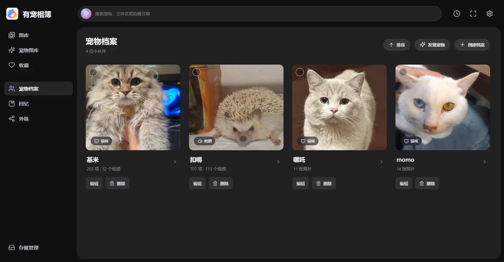
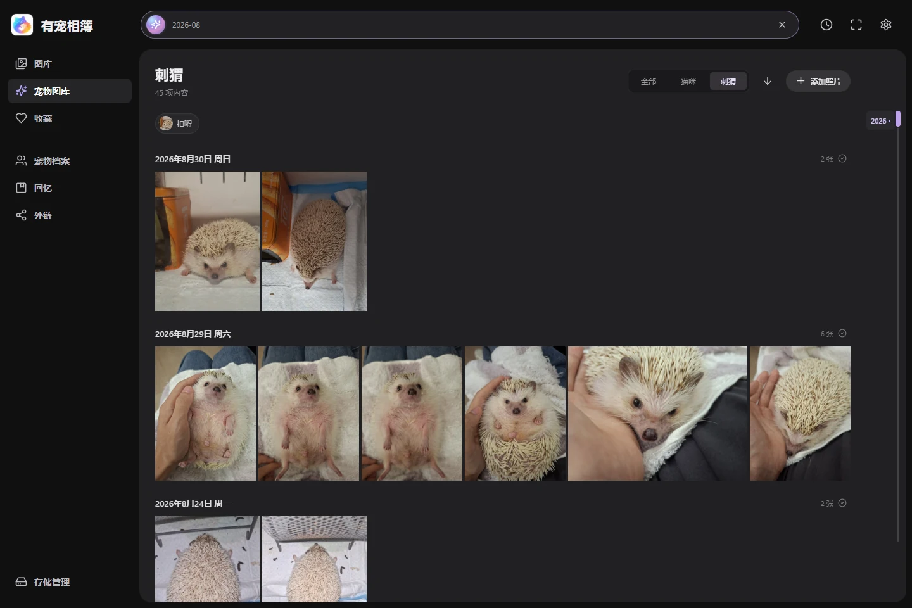
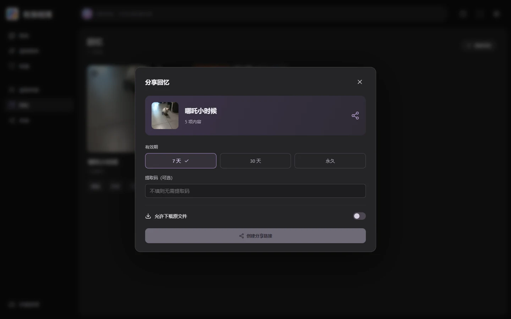

<p align="center"></p>
<h1 align="center">有宠相簿 · OusePet</h1>
<p align="center">把它们的日常，留成回忆。</p>
<p align="center">为猫咪和刺猬准备的自托管相簿：本地识别、宠物档案、照片与视频、回忆分享。</p>
<p align="center"><a href="https://0use-te.github.io/OusePet/">项目网站</a> · <a href="docs/deployment.md">部署说明</a> · <a href="#开发与验证">开发与验证</a> · <a href="LICENSE">MIT License</a></p>



## 已实现

- **照片和视频统一浏览**：按拍摄日期排列，支持物种筛选、搜索、收藏、日期跳转、批量选择和键盘操作。
- **本地识别猫咪与刺猬**：检测宠物区域、提取 DINOv2 特征，至少 5 项不同媒体形成未命名档案。支持命名、种类更正、多选合并、调整顺序和自定义封面。
- **持续增量处理**：自动检查新增或变化的文件，复用索引和识别结果，保留手动归属与排除记录。扫描可暂停、继续、取消，任务历史可清理。
- **视频采样识别**：FFmpeg 提取画面，命中附近补采样，支持精细重扫、多宠物归属、片段定位及视频封面。
- **回忆**：从图库多选添加、移除内容，编辑名称和封面，多选合并。
- **回忆分享**：独立访客服务，支持有效期、提取码、下载权限、域名与外部端口、外链卡片、链接复制和删除。
- **NAS / Docker**：FastAPI + SQLite，原媒体目录只读挂载，支持 CPU 和 NVIDIA GPU，适配桌面与手机。

> 当前为持续开发版本。自动分组可能误分或漏分，需要人工整理；视觉相似度不是身份准确率。模型权重、DINOv2 缓存、照片、数据库和运行报告不随仓库分发，首次部署需要额外准备模型资源。

## 界面

<details><summary>宠物图库与时间线</summary>



</details>

<details><summary>回忆分享</summary>



</details>

截图来自运行中的软件，展示时隐藏了无关分组及分享记录，不包含可用分享令牌。项目网站是静态介绍页，不连接用户的 NAS 或数据库。

## 部署

完整步骤、模型清单和限制见 **[部署说明](docs/deployment.md)**。

```bash
git clone https://github.com/0use-TE/OusePet.git
cd OusePet
npm --prefix frontend ci
npm --prefix frontend run build

# 准备模型、DINOv2 源码缓存和照片目录后：
OUSEPET_PHOTOS=/absolute/path/to/photos docker compose up -d --build
```

| 服务 | 默认地址 | 用途 |
| --- | --- | --- |
| 管理端 | `http://NAS-IP:8766` | 图库、识别、档案与设置，仅用于可信网络 |
| 分享端 | `http://NAS-IP:8767/s/...` | 只读访客页面，公网反代应指向此端口 |

管理端目前没有登录系统，不应直接暴露到公网。分享域名与外部端口仅用于生成链接，DNS、路由器转发、HTTPS 和反代需要自行配置。

## 开发与验证

```bash
# 安装 Python / PyTorch 依赖及模型后启动 API
python -m uvicorn ousepet.api:app --host 127.0.0.1 --port 8766
# 另一个终端运行前端；Vite 将 /api 转发到后端
npm --prefix frontend run dev

npm --prefix frontend run build
python -m compileall -q ousepet scripts
python scripts/check_website.py

# 已安装运行依赖时，使用临时数据库验证关键业务
python scripts/test_sharing.py
python scripts/test_incremental_scan.py
python scripts/test_storage_removal.py
python scripts/test_videos.py
```

浏览器脚本使用 Playwright、httpx 和 Microsoft Edge；部分测试还需要本地模型、视频样例或 NAS 环境，详见脚本说明。GitHub Actions 执行前端构建、Python 语法和网站资源检查，不声称覆盖 GPU 或模型准确率。

## 目录

```text
ousepet/               FastAPI、索引、识别、视频、身份分组、分享服务
frontend/              React + TypeScript 应用
website/               Pages 静态网站与脱敏截图
docs/deployment.md     通用部署与模型资源说明
deploy/                fnOS 包模板及原开发环境部署记录
scripts/               模型实验、数据处理、业务与浏览器验证
.github/workflows/     源码检查、GitHub Pages 部署
```

修改 `website/` 后推送到 `main`，`Deploy project website` 工作流会校验资源并仅上传网站目录到 Pages。支持手动触发，资源路径适配 `/OusePet/` 项目子目录。

本地预览：`python -m http.server 8088 --directory website`，打开 `http://localhost:8088`。

## 许可与模型

源码沿用 [MIT License](LICENSE)。PyTorch、Ultralytics、DINOv2 及模型权重遵循各自许可证；MIT 不改变第三方组件或模型的授权条件。自训练刺猬模型的样本规模有限，不代表对所有刺猬的识别或身份区分准确率。
